# [📈 Live Status](https://TW641.github.io/status): <!--live status--> **🟩 All systems operational**

This repository contains the open-source uptime monitor and status page for [Shiyu Liou - TW641 - Formerly TWShiyuLiou1997](https://TW641.github.io), powered by [Upptime](https://github.com/upptime/upptime).

With [Upptime](https://upptime.js.org), you can get your own unlimited and free uptime monitor and status page, powered entirely by a GitHub repository. We use [Issues](https://github.com/TW641/status/issues) as incident reports, [Actions](https://github.com/TW641/status/actions) as uptime monitors, and [Pages](https://TW641.github.io/status) for the status page.

<!--start: status pages-->
<!-- This summary is generated by Upptime (https://github.com/upptime/upptime) -->
<!-- Do not edit this manually, your changes will be overwritten -->
<!-- prettier-ignore -->
| URL | Status | History | Response Time | Uptime |
| --- | ------ | ------- | ------------- | ------ |
|  [TW641 Status - Cloudflare Pages](https://tw641status.pages.dev/) | 🟩 Up | [tw-641-status-cloudflare-pages.yml](https://github.com/TW641/status/commits/HEAD/history/tw-641-status-cloudflare-pages.yml) | 

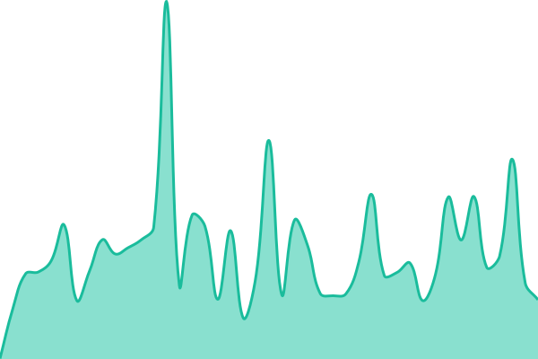 237ms
     
 | 

<a href="https://TW641.github.io/status/history/tw-641-status-cloudflare-pages">100.00%</a>
    

|  [TW641 Uptimer - Cloudflare Pages](https://tw641uptimer.pages.dev/) | 🟩 Up | [tw-641-uptimer-cloudflare-pages.yml](https://github.com/TW641/status/commits/HEAD/history/tw-641-uptimer-cloudflare-pages.yml) | 

 216ms
     
 | 

<a href="https://TW641.github.io/status/history/tw-641-uptimer-cloudflare-pages">100.00%</a>
    

|  [TW641 Status - GitHub Pages](https://tw641.github.io/status/) | 🟩 Up | [tw-641-status-git-hub-pages.yml](https://github.com/TW641/status/commits/HEAD/history/tw-641-status-git-hub-pages.yml) | 

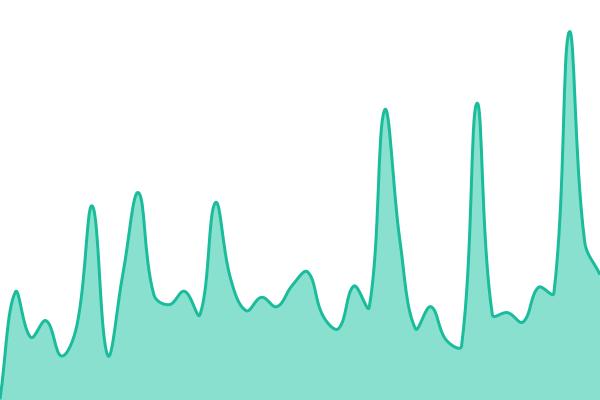 170ms
     
 | 

<a href="https://TW641.github.io/status/history/tw-641-status-git-hub-pages">100.00%</a>
    

|  [TW641 GitHub Pages 官方主站 - 首頁](https://tw641.github.io/) | 🟩 Up | [tw-641-git-hub-pages.yml](https://github.com/TW641/status/commits/HEAD/history/tw-641-git-hub-pages.yml) | 

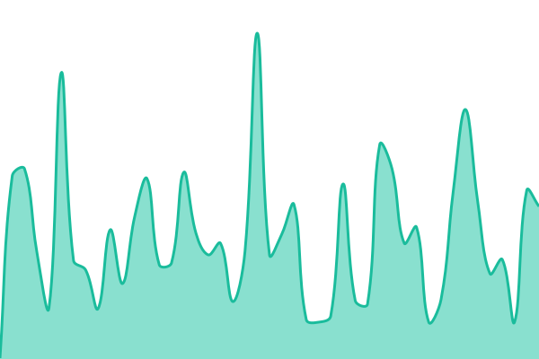 143ms
     
 | 

<a href="https://TW641.github.io/status/history/tw-641-git-hub-pages">100.00%</a>
    

|  [TW641 GitHub Pages 官方主站 - daves-guitar-2026](https://tw641.github.io/daves-guitar-2026/) | 🟩 Up | [tw-641-git-hub-pages-daves-guitar-2026.yml](https://github.com/TW641/status/commits/HEAD/history/tw-641-git-hub-pages-daves-guitar-2026.yml) | 

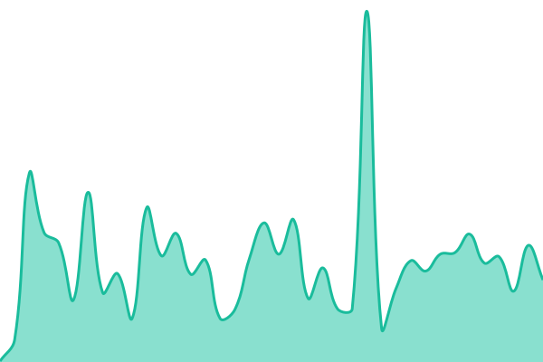 129ms
     
 | 

<a href="https://TW641.github.io/status/history/tw-641-git-hub-pages-daves-guitar-2026">100.00%</a>
    

|  [TW641 GitHub Pages 官方主站 - Padavan-CAKE](https://tw641.github.io/Padavan-CAKE/) | 🟩 Up | [tw-641-git-hub-pages-padavan-cake.yml](https://github.com/TW641/status/commits/HEAD/history/tw-641-git-hub-pages-padavan-cake.yml) | 

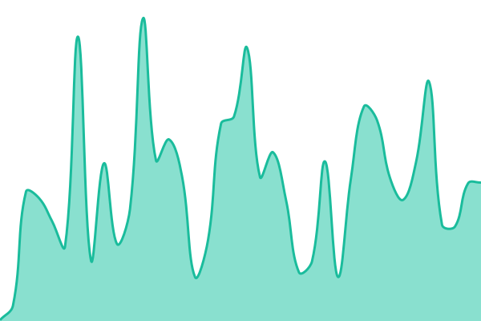 164ms
     
 | 

<a href="https://TW641.github.io/status/history/tw-641-git-hub-pages-padavan-cake">100.00%</a>
    

|  [TW641 GitHub Pages 官方主站 - sch_cake](https://tw641.github.io/sch_cake/) | 🟩 Up | [tw-641-git-hub-pages-sch-cake.yml](https://github.com/TW641/status/commits/HEAD/history/tw-641-git-hub-pages-sch-cake.yml) | 

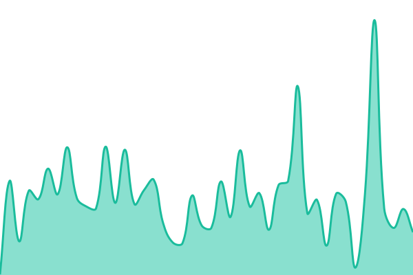 148ms
     
 | 

<a href="https://TW641.github.io/status/history/tw-641-git-hub-pages-sch-cake">100.00%</a>
    

|  [TW641 GitHub Pages 官方主站 - padavan-builder-workflow](https://tw641.github.io/padavan-builder-workflow/) | 🟩 Up | [tw-641-git-hub-pages-padavan-builder-workflow.yml](https://github.com/TW641/status/commits/HEAD/history/tw-641-git-hub-pages-padavan-builder-workflow.yml) | 

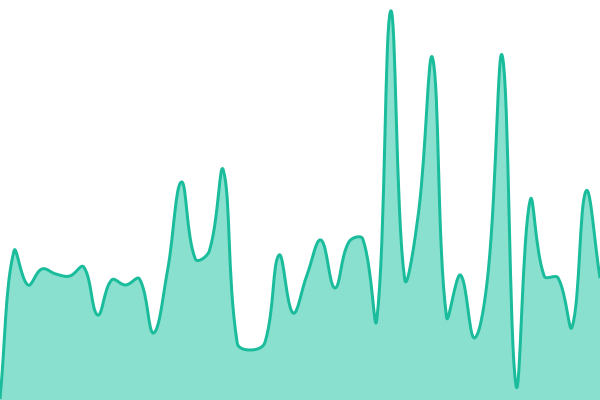 151ms
     
 | 

<a href="https://TW641.github.io/status/history/tw-641-git-hub-pages-padavan-builder-workflow">100.00%</a>
    

|  [TW641 GitHub Pages 官方主站 - padavan-ng](https://tw641.github.io/padavan-ng/) | 🟩 Up | [tw-641-git-hub-pages-padavan-ng.yml](https://github.com/TW641/status/commits/HEAD/history/tw-641-git-hub-pages-padavan-ng.yml) | 

 158ms
     
 | 

<a href="https://TW641.github.io/status/history/tw-641-git-hub-pages-padavan-ng">100.00%</a>
    

|  [TW641 GitHub Pages 官方主站 - padavan-4.4](https://tw641.github.io/padavan-4.4/) | 🟩 Up | [tw-641-git-hub-pages-padavan-4-4.yml](https://github.com/TW641/status/commits/HEAD/history/tw-641-git-hub-pages-padavan-4-4.yml) | 

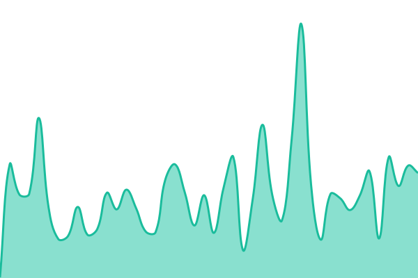 160ms
     
 | 

<a href="https://TW641.github.io/status/history/tw-641-git-hub-pages-padavan-4-4">100.00%</a>
    

|  [TW641 Cloudflare Pages 備援網站 - 首頁](https://tw641.pages.dev/) | 🟩 Up | [tw-641-cloudflare-pages.yml](https://github.com/TW641/status/commits/HEAD/history/tw-641-cloudflare-pages.yml) | 

 153ms
     
 | 

<a href="https://TW641.github.io/status/history/tw-641-cloudflare-pages">100.00%</a>
    

|  [TW641 Cloudflare Pages 備援網站 - daves-guitar-2026](https://tw641.pages.dev/daves-guitar-2026/) | 🟩 Up | [tw-641-cloudflare-pages-daves-guitar-2026.yml](https://github.com/TW641/status/commits/HEAD/history/tw-641-cloudflare-pages-daves-guitar-2026.yml) | 

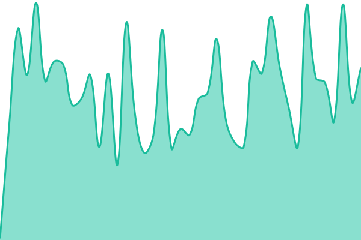 116ms
     
 | 

<a href="https://TW641.github.io/status/history/tw-641-cloudflare-pages-daves-guitar-2026">100.00%</a>
    

|  [TW641 Cloudflare Pages 備援網站 - Padavan-CAKE](https://tw641.pages.dev/Padavan-CAKE/) | 🟩 Up | [tw-641-cloudflare-pages-padavan-cake.yml](https://github.com/TW641/status/commits/HEAD/history/tw-641-cloudflare-pages-padavan-cake.yml) | 

 128ms
     
 | 

<a href="https://TW641.github.io/status/history/tw-641-cloudflare-pages-padavan-cake">100.00%</a>
    

|  [TW641 Cloudflare Pages 備援網站 - sch_cake](https://tw641.pages.dev/sch_cake/) | 🟩 Up | [tw-641-cloudflare-pages-sch-cake.yml](https://github.com/TW641/status/commits/HEAD/history/tw-641-cloudflare-pages-sch-cake.yml) | 

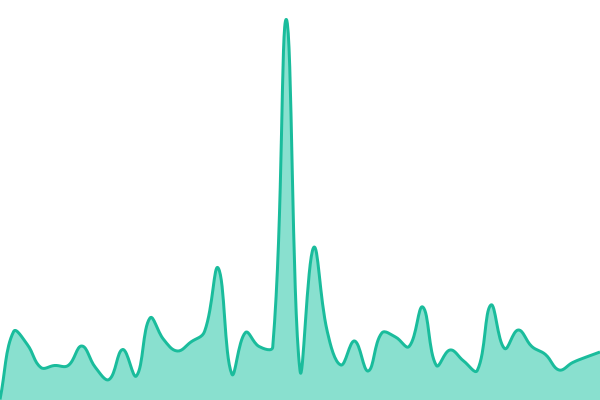 122ms
     
 | 

<a href="https://TW641.github.io/status/history/tw-641-cloudflare-pages-sch-cake">100.00%</a>
    

|  [TW641 Cloudflare Pages 備援網站 - padavan-builder-workflow](https://tw641.pages.dev/padavan-builder-workflow/) | 🟩 Up | [tw-641-cloudflare-pages-padavan-builder-workflow.yml](https://github.com/TW641/status/commits/HEAD/history/tw-641-cloudflare-pages-padavan-builder-workflow.yml) | 

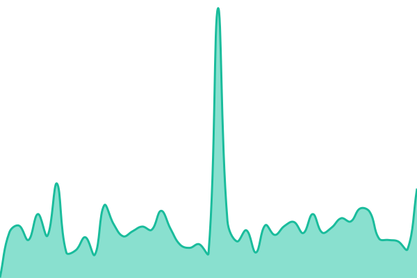 109ms
     
 | 

<a href="https://TW641.github.io/status/history/tw-641-cloudflare-pages-padavan-builder-workflow">100.00%</a>
    

|  [TW641 Cloudflare Pages 備援網站 - padavan-ng](https://tw641.pages.dev/padavan-ng/) | 🟩 Up | [tw-641-cloudflare-pages-padavan-ng.yml](https://github.com/TW641/status/commits/HEAD/history/tw-641-cloudflare-pages-padavan-ng.yml) | 

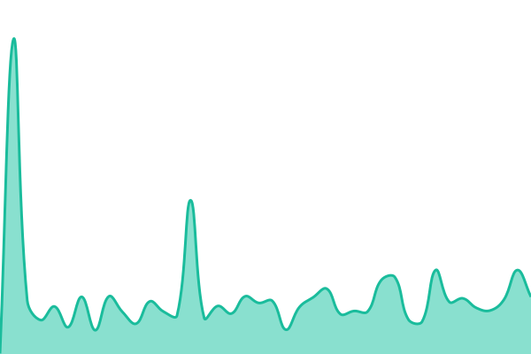 107ms
     
 | 

<a href="https://TW641.github.io/status/history/tw-641-cloudflare-pages-padavan-ng">100.00%</a>
    

|  [TW641 Cloudflare Pages 備援網站 - padavan-4.4](https://tw641.pages.dev/padavan-4.4/) | 🟩 Up | [tw-641-cloudflare-pages-padavan-4-4.yml](https://github.com/TW641/status/commits/HEAD/history/tw-641-cloudflare-pages-padavan-4-4.yml) | 

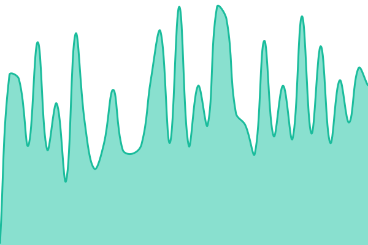 121ms
     
 | 

<a href="https://TW641.github.io/status/history/tw-641-cloudflare-pages-padavan-4-4">100.00%</a>
    

|  [TW641 Cloudflare Workers 備援網站 - 首頁](https://www.tw641.workers.dev/) | 🟩 Up | [tw-641-cloudflare-workers.yml](https://github.com/TW641/status/commits/HEAD/history/tw-641-cloudflare-workers.yml) | 

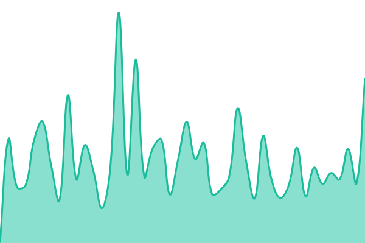 238ms
     
 | 

<a href="https://TW641.github.io/status/history/tw-641-cloudflare-workers">100.00%</a>
    

|  [TW641 Cloudflare Workers 備援網站 - daves-guitar-2026](https://www.tw641.workers.dev/daves-guitar-2026/) | 🟩 Up | [tw-641-cloudflare-workers-daves-guitar-2026.yml](https://github.com/TW641/status/commits/HEAD/history/tw-641-cloudflare-workers-daves-guitar-2026.yml) | 

 170ms
     
 | 

<a href="https://TW641.github.io/status/history/tw-641-cloudflare-workers-daves-guitar-2026">100.00%</a>
    

|  [TW641 Cloudflare Workers 備援網站 - Padavan-CAKE](https://www.tw641.workers.dev/Padavan-CAKE/) | 🟩 Up | [tw-641-cloudflare-workers-padavan-cake.yml](https://github.com/TW641/status/commits/HEAD/history/tw-641-cloudflare-workers-padavan-cake.yml) | 

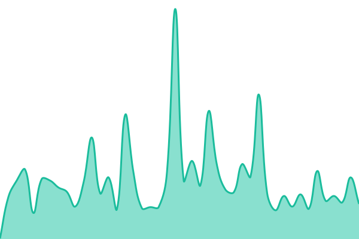 195ms
     
 | 

<a href="https://TW641.github.io/status/history/tw-641-cloudflare-workers-padavan-cake">100.00%</a>
    

|  [TW641 Cloudflare Workers 備援網站 - sch_cake](https://www.tw641.workers.dev/sch_cake/) | 🟩 Up | [tw-641-cloudflare-workers-sch-cake.yml](https://github.com/TW641/status/commits/HEAD/history/tw-641-cloudflare-workers-sch-cake.yml) | 

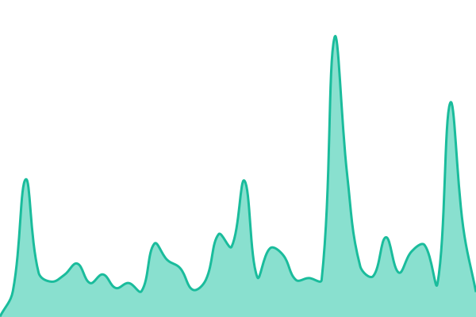 176ms
     
 | 

<a href="https://TW641.github.io/status/history/tw-641-cloudflare-workers-sch-cake">100.00%</a>
    

|  [TW641 Cloudflare Workers 備援網站 - padavan-builder-workflow](https://www.tw641.workers.dev/padavan-builder-workflow/) | 🟩 Up | [tw-641-cloudflare-workers-padavan-builder-workflow.yml](https://github.com/TW641/status/commits/HEAD/history/tw-641-cloudflare-workers-padavan-builder-workflow.yml) | 

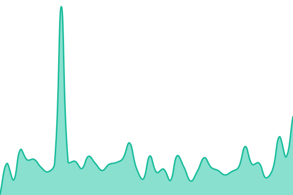 192ms
     
 | 

<a href="https://TW641.github.io/status/history/tw-641-cloudflare-workers-padavan-builder-workflow">100.00%</a>
    

|  [TW641 Cloudflare Workers 備援網站 - padavan-ng](https://www.tw641.workers.dev/padavan-ng/) | 🟩 Up | [tw-641-cloudflare-workers-padavan-ng.yml](https://github.com/TW641/status/commits/HEAD/history/tw-641-cloudflare-workers-padavan-ng.yml) | 

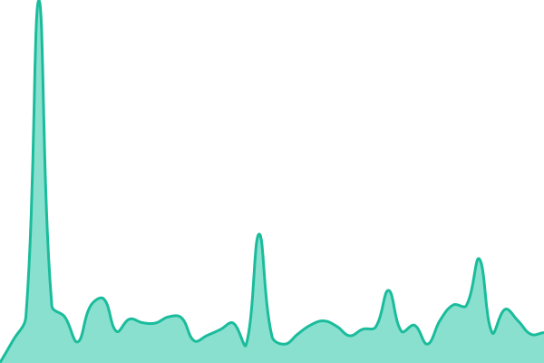 172ms
     
 | 

<a href="https://TW641.github.io/status/history/tw-641-cloudflare-workers-padavan-ng">100.00%</a>
    

|  [TW641 Cloudflare Workers 備援網站 - padavan-4.4](https://www.tw641.workers.dev/padavan-4.4/) | 🟩 Up | [tw-641-cloudflare-workers-padavan-4-4.yml](https://github.com/TW641/status/commits/HEAD/history/tw-641-cloudflare-workers-padavan-4-4.yml) | 

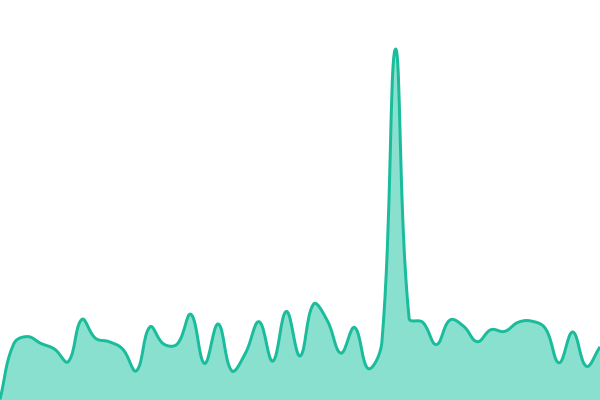 205ms
     
 | 

<a href="https://TW641.github.io/status/history/tw-641-cloudflare-workers-padavan-4-4">100.00%</a>
    

|  [TW641 Firebase Hosting 備援網站 - 首頁](https://tw641t.web.app/) | 🟩 Up | [tw-641-firebase-hosting.yml](https://github.com/TW641/status/commits/HEAD/history/tw-641-firebase-hosting.yml) | 

 121ms
     
 | 

<a href="https://TW641.github.io/status/history/tw-641-firebase-hosting">100.00%</a>
    

|  [TW641 Firebase Hosting 備援網站 - daves-guitar-2026](https://tw641t.web.app/daves-guitar-2026/) | 🟩 Up | [tw-641-firebase-hosting-daves-guitar-2026.yml](https://github.com/TW641/status/commits/HEAD/history/tw-641-firebase-hosting-daves-guitar-2026.yml) | 

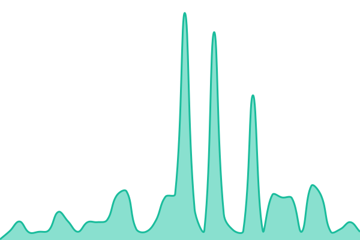 68ms
     
 | 

<a href="https://TW641.github.io/status/history/tw-641-firebase-hosting-daves-guitar-2026">100.00%</a>
    

|  [TW641 Firebase Hosting 備援網站 - Padavan-CAKE](https://tw641t.web.app/Padavan-CAKE/) | 🟩 Up | [tw-641-firebase-hosting-padavan-cake.yml](https://github.com/TW641/status/commits/HEAD/history/tw-641-firebase-hosting-padavan-cake.yml) | 

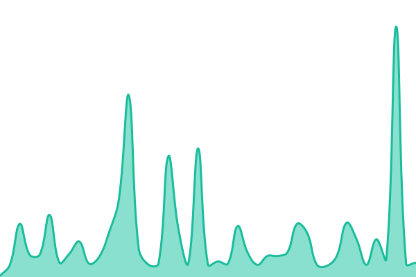 41ms
     
 | 

<a href="https://TW641.github.io/status/history/tw-641-firebase-hosting-padavan-cake">100.00%</a>
    

|  [TW641 Firebase Hosting 備援網站 - sch_cake](https://tw641t.web.app/sch_cake/) | 🟩 Up | [tw-641-firebase-hosting-sch-cake.yml](https://github.com/TW641/status/commits/HEAD/history/tw-641-firebase-hosting-sch-cake.yml) | 

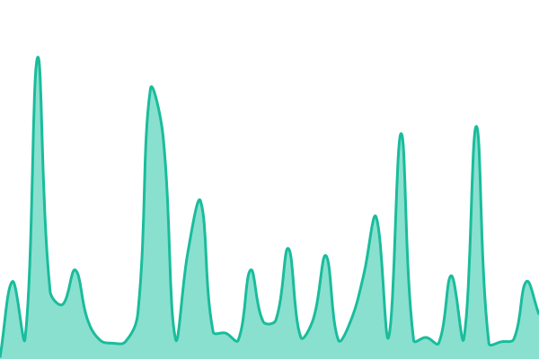 37ms
     
 | 

<a href="https://TW641.github.io/status/history/tw-641-firebase-hosting-sch-cake">100.00%</a>
    

|  [TW641 Firebase Hosting 備援網站 - padavan-builder-workflow](https://tw641t.web.app/padavan-builder-workflow/) | 🟩 Up | [tw-641-firebase-hosting-padavan-builder-workflow.yml](https://github.com/TW641/status/commits/HEAD/history/tw-641-firebase-hosting-padavan-builder-workflow.yml) | 

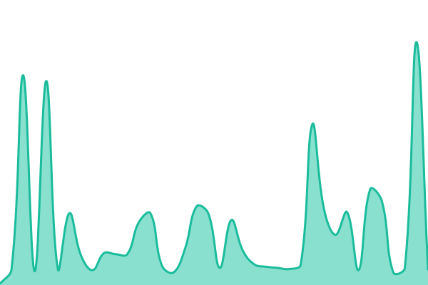 59ms
     
 | 

<a href="https://TW641.github.io/status/history/tw-641-firebase-hosting-padavan-builder-workflow">100.00%</a>
    

|  [TW641 Firebase Hosting 備援網站 - padavan-ng](https://tw641t.web.app/padavan-ng/) | 🟩 Up | [tw-641-firebase-hosting-padavan-ng.yml](https://github.com/TW641/status/commits/HEAD/history/tw-641-firebase-hosting-padavan-ng.yml) | 

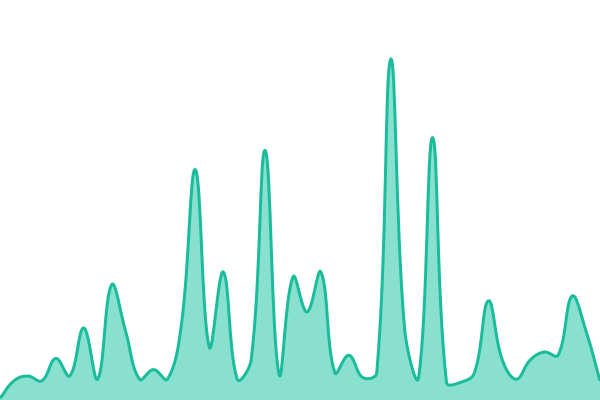 65ms
     
 | 

<a href="https://TW641.github.io/status/history/tw-641-firebase-hosting-padavan-ng">100.00%</a>
    

|  [TW641 Firebase Hosting 備援網站 - padavan-4.4](https://tw641t.web.app/padavan-4.4/) | 🟩 Up | [tw-641-firebase-hosting-padavan-4-4.yml](https://github.com/TW641/status/commits/HEAD/history/tw-641-firebase-hosting-padavan-4-4.yml) | 

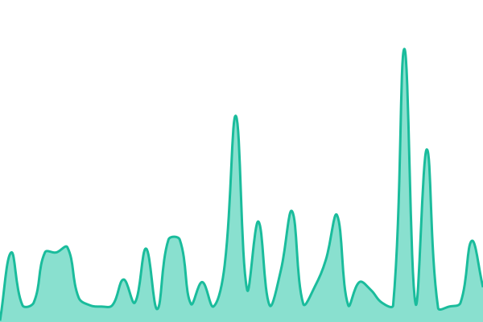 34ms
     
 | 

<a href="https://TW641.github.io/status/history/tw-641-firebase-hosting-padavan-4-4">100.00%</a>
    

|  [TW641 FirebaseApp.com 備用網域 - 首頁](https://tw641t.firebaseapp.com/) | 🟩 Up | [tw-641-firebase-app-com.yml](https://github.com/TW641/status/commits/HEAD/history/tw-641-firebase-app-com.yml) | 

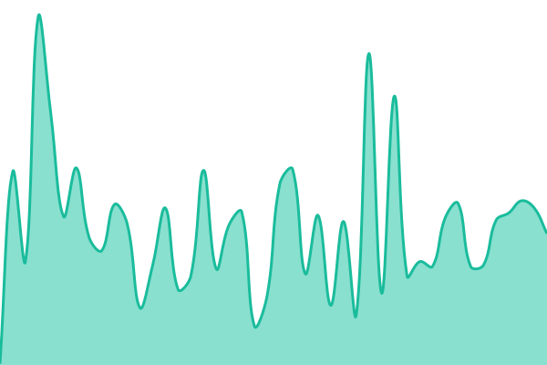 129ms
     
 | 

<a href="https://TW641.github.io/status/history/tw-641-firebase-app-com">100.00%</a>
    

|  [TW641 FirebaseApp.com 備用網域 - daves-guitar-2026](https://tw641t.firebaseapp.com/daves-guitar-2026/) | 🟩 Up | [tw-641-firebase-app-com-daves-guitar-2026.yml](https://github.com/TW641/status/commits/HEAD/history/tw-641-firebase-app-com-daves-guitar-2026.yml) | 

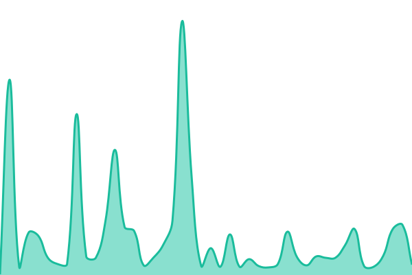 52ms
     
 | 

<a href="https://TW641.github.io/status/history/tw-641-firebase-app-com-daves-guitar-2026">100.00%</a>
    

|  [TW641 FirebaseApp.com 備用網域 - Padavan-CAKE](https://tw641t.firebaseapp.com/Padavan-CAKE/) | 🟩 Up | [tw-641-firebase-app-com-padavan-cake.yml](https://github.com/TW641/status/commits/HEAD/history/tw-641-firebase-app-com-padavan-cake.yml) | 

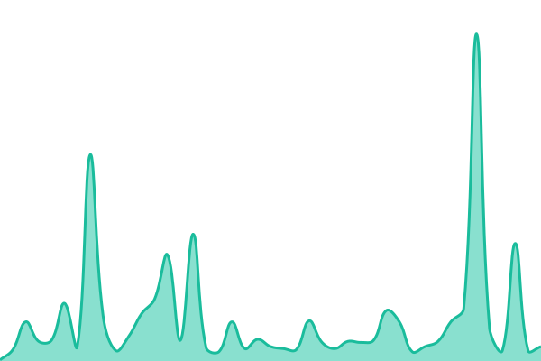 40ms
     
 | 

<a href="https://TW641.github.io/status/history/tw-641-firebase-app-com-padavan-cake">100.00%</a>
    

|  [TW641 FirebaseApp.com 備用網域 - sch_cake](https://tw641t.firebaseapp.com/sch_cake/) | 🟩 Up | [tw-641-firebase-app-com-sch-cake.yml](https://github.com/TW641/status/commits/HEAD/history/tw-641-firebase-app-com-sch-cake.yml) | 

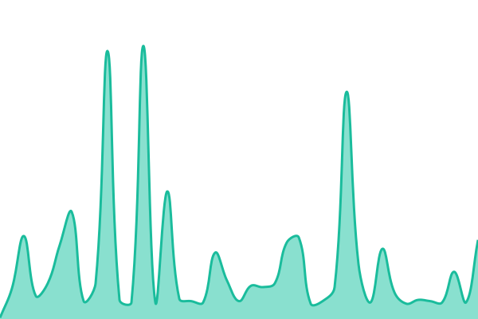 49ms
     
 | 

<a href="https://TW641.github.io/status/history/tw-641-firebase-app-com-sch-cake">100.00%</a>
    

|  [TW641 FirebaseApp.com 備用網域 - padavan-builder-workflow](https://tw641t.firebaseapp.com/padavan-builder-workflow/) | 🟩 Up | [tw-641-firebase-app-com-padavan-builder-workflow.yml](https://github.com/TW641/status/commits/HEAD/history/tw-641-firebase-app-com-padavan-builder-workflow.yml) | 

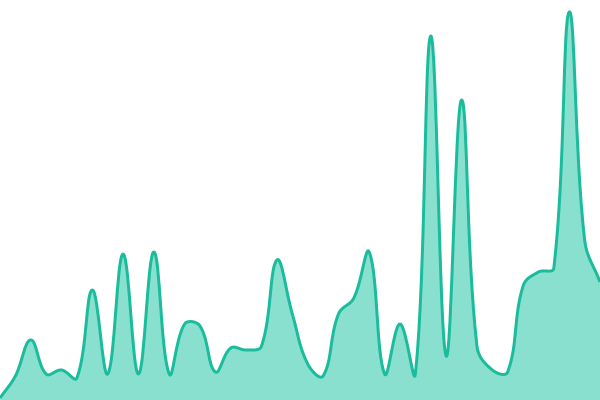 43ms
     
 | 

<a href="https://TW641.github.io/status/history/tw-641-firebase-app-com-padavan-builder-workflow">100.00%</a>
    

|  [TW641 FirebaseApp.com 備用網域 - padavan-ng](https://tw641t.firebaseapp.com/padavan-ng/) | 🟩 Up | [tw-641-firebase-app-com-padavan-ng.yml](https://github.com/TW641/status/commits/HEAD/history/tw-641-firebase-app-com-padavan-ng.yml) | 

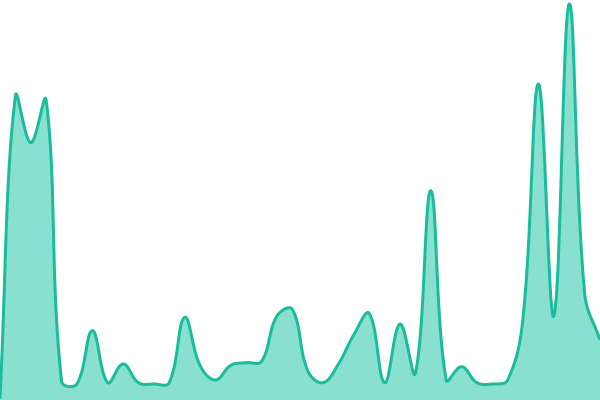 51ms
     
 | 

<a href="https://TW641.github.io/status/history/tw-641-firebase-app-com-padavan-ng">100.00%</a>
    

|  [TW641 FirebaseApp.com 備用網域 - padavan-4.4](https://tw641t.firebaseapp.com/padavan-4.4/) | 🟩 Up | [tw-641-firebase-app-com-padavan-4-4.yml](https://github.com/TW641/status/commits/HEAD/history/tw-641-firebase-app-com-padavan-4-4.yml) | 

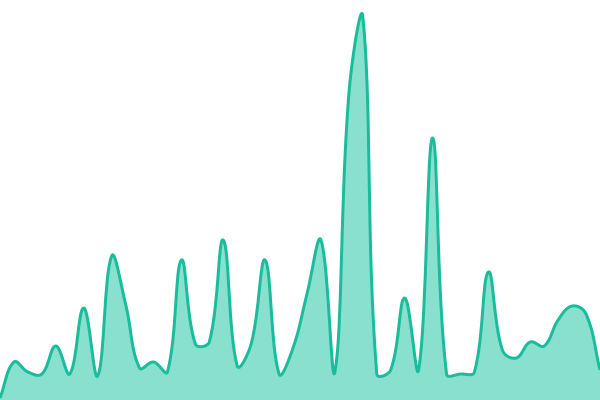 49ms
     
 | 

<a href="https://TW641.github.io/status/history/tw-641-firebase-app-com-padavan-4-4">100.00%</a>
    

|  [TW641 GitLab Pages 備援網站 - 首頁](https://tw641.gitlab.io/) | 🟩 Up | [tw-641-git-lab-pages.yml](https://github.com/TW641/status/commits/HEAD/history/tw-641-git-lab-pages.yml) | 

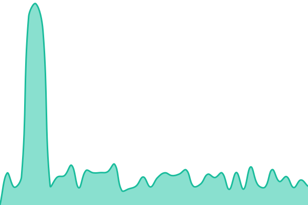 762ms
     
 | 

<a href="https://TW641.github.io/status/history/tw-641-git-lab-pages">100.00%</a>
    

|  [TW641 GitLab Pages 備援網站 - daves-guitar-2026](https://tw641.gitlab.io/daves-guitar-2026/) | 🟩 Up | [tw-641-git-lab-pages-daves-guitar-2026.yml](https://github.com/TW641/status/commits/HEAD/history/tw-641-git-lab-pages-daves-guitar-2026.yml) | 

 464ms
     
 | 

<a href="https://TW641.github.io/status/history/tw-641-git-lab-pages-daves-guitar-2026">100.00%</a>
    

|  [TW641 GitLab Pages 備援網站 - Padavan-CAKE](https://tw641.gitlab.io/Padavan-CAKE/) | 🟩 Up | [tw-641-git-lab-pages-padavan-cake.yml](https://github.com/TW641/status/commits/HEAD/history/tw-641-git-lab-pages-padavan-cake.yml) | 

 423ms
     
 | 

<a href="https://TW641.github.io/status/history/tw-641-git-lab-pages-padavan-cake">100.00%</a>
    

|  [TW641 GitLab Pages 備援網站 - sch_cake](https://tw641.gitlab.io/sch_cake/) | 🟩 Up | [tw-641-git-lab-pages-sch-cake.yml](https://github.com/TW641/status/commits/HEAD/history/tw-641-git-lab-pages-sch-cake.yml) | 

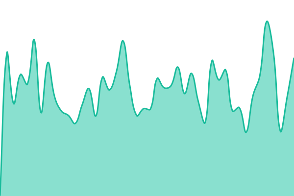 511ms
     
 | 

<a href="https://TW641.github.io/status/history/tw-641-git-lab-pages-sch-cake">100.00%</a>
    

|  [TW641 GitLab Pages 備援網站 - padavan-builder-workflow](https://tw641.gitlab.io/padavan-builder-workflow/) | 🟩 Up | [tw-641-git-lab-pages-padavan-builder-workflow.yml](https://github.com/TW641/status/commits/HEAD/history/tw-641-git-lab-pages-padavan-builder-workflow.yml) | 

 480ms
     
 | 

<a href="https://TW641.github.io/status/history/tw-641-git-lab-pages-padavan-builder-workflow">100.00%</a>
    

|  [TW641 GitLab Pages 備援網站 - padavan-ng](https://tw641.gitlab.io/padavan-ng/) | 🟩 Up | [tw-641-git-lab-pages-padavan-ng.yml](https://github.com/TW641/status/commits/HEAD/history/tw-641-git-lab-pages-padavan-ng.yml) | 

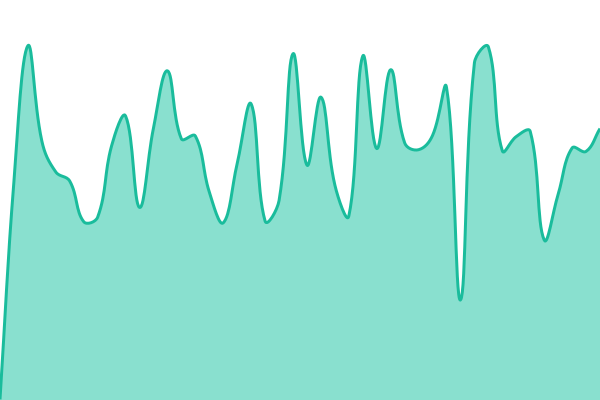 470ms
     
 | 

<a href="https://TW641.github.io/status/history/tw-641-git-lab-pages-padavan-ng">100.00%</a>
    

|  [TW641 GitLab Pages 備援網站 - padavan-4.4](https://tw641.gitlab.io/padavan-4.4/) | 🟩 Up | [tw-641-git-lab-pages-padavan-4-4.yml](https://github.com/TW641/status/commits/HEAD/history/tw-641-git-lab-pages-padavan-4-4.yml) | 

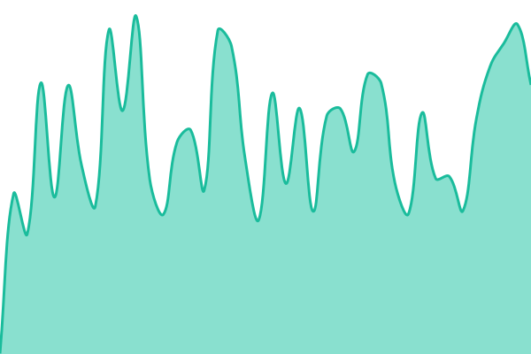 460ms
     
 | 

<a href="https://TW641.github.io/status/history/tw-641-git-lab-pages-padavan-4-4">100.00%</a>
    

|  [TW641 Netlify 備援網站 - 首頁](https://tw641.netlify.app/) | 🟩 Up | [tw-641-netlify.yml](https://github.com/TW641/status/commits/HEAD/history/tw-641-netlify.yml) | 

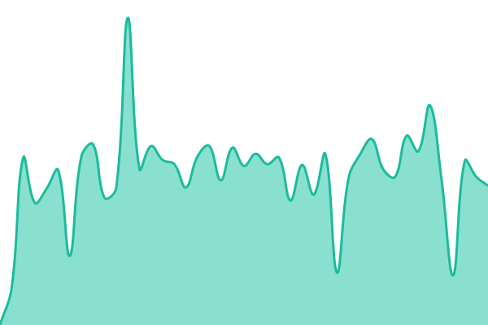 694ms
     
 | 

<a href="https://TW641.github.io/status/history/tw-641-netlify">100.00%</a>
    

|  [TW641 Netlify 備援網站 - daves-guitar-2026](https://tw641.netlify.app/daves-guitar-2026/) | 🟩 Up | [tw-641-netlify-daves-guitar-2026.yml](https://github.com/TW641/status/commits/HEAD/history/tw-641-netlify-daves-guitar-2026.yml) | 

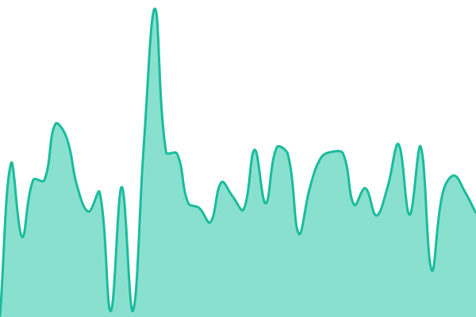 355ms
     
 | 

<a href="https://TW641.github.io/status/history/tw-641-netlify-daves-guitar-2026">100.00%</a>
    

|  [TW641 Netlify 備援網站 - Padavan-CAKE](https://tw641.netlify.app/Padavan-CAKE/) | 🟩 Up | [tw-641-netlify-padavan-cake.yml](https://github.com/TW641/status/commits/HEAD/history/tw-641-netlify-padavan-cake.yml) | 

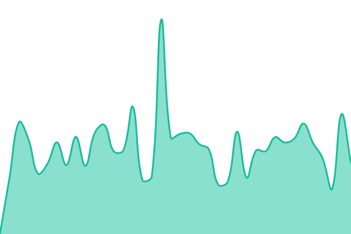 376ms
     
 | 

<a href="https://TW641.github.io/status/history/tw-641-netlify-padavan-cake">100.00%</a>
    

|  [TW641 Netlify 備援網站 - sch_cake](https://tw641.netlify.app/sch_cake/) | 🟩 Up | [tw-641-netlify-sch-cake.yml](https://github.com/TW641/status/commits/HEAD/history/tw-641-netlify-sch-cake.yml) | 

 369ms
     
 | 

<a href="https://TW641.github.io/status/history/tw-641-netlify-sch-cake">100.00%</a>
    

|  [TW641 Netlify 備援網站 - padavan-builder-workflow](https://tw641.netlify.app/padavan-builder-workflow/) | 🟩 Up | [tw-641-netlify-padavan-builder-workflow.yml](https://github.com/TW641/status/commits/HEAD/history/tw-641-netlify-padavan-builder-workflow.yml) | 

 350ms
     
 | 

<a href="https://TW641.github.io/status/history/tw-641-netlify-padavan-builder-workflow">100.00%</a>
    

|  [TW641 Netlify 備援網站 - padavan-ng](https://tw641.netlify.app/padavan-ng/) | 🟩 Up | [tw-641-netlify-padavan-ng.yml](https://github.com/TW641/status/commits/HEAD/history/tw-641-netlify-padavan-ng.yml) | 

 350ms
     
 | 

<a href="https://TW641.github.io/status/history/tw-641-netlify-padavan-ng">100.00%</a>
    

|  [TW641 Netlify 備援網站 - padavan-4.4](https://tw641.netlify.app/padavan-4.4/) | 🟩 Up | [tw-641-netlify-padavan-4-4.yml](https://github.com/TW641/status/commits/HEAD/history/tw-641-netlify-padavan-4-4.yml) | 

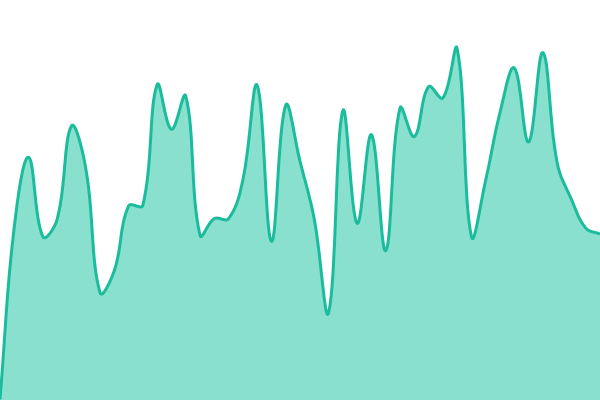 358ms
     
 | 

<a href="https://TW641.github.io/status/history/tw-641-netlify-padavan-4-4">100.00%</a>
    

|  [TW641 Vercel 備援網站 - 首頁](https://tw641.vercel.app/) | 🟩 Up | [tw-641-vercel.yml](https://github.com/TW641/status/commits/HEAD/history/tw-641-vercel.yml) | 

 209ms
     
 | 

<a href="https://TW641.github.io/status/history/tw-641-vercel">100.00%</a>
    

|  [TW641 Vercel 備援網站 - daves-guitar-2026](https://tw641.vercel.app/daves-guitar-2026/) | 🟩 Up | [tw-641-vercel-daves-guitar-2026.yml](https://github.com/TW641/status/commits/HEAD/history/tw-641-vercel-daves-guitar-2026.yml) | 

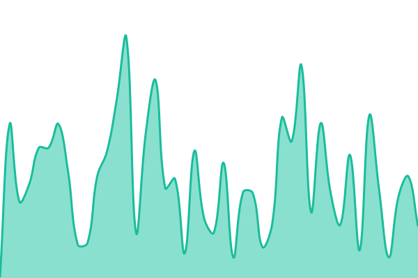 147ms
     
 | 

<a href="https://TW641.github.io/status/history/tw-641-vercel-daves-guitar-2026">100.00%</a>
    

|  [TW641 Vercel 備援網站 - Padavan-CAKE](https://tw641.vercel.app/Padavan-CAKE/) | 🟩 Up | [tw-641-vercel-padavan-cake.yml](https://github.com/TW641/status/commits/HEAD/history/tw-641-vercel-padavan-cake.yml) | 

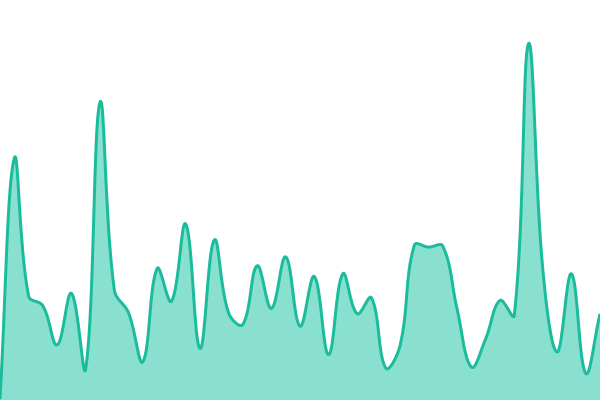 137ms
     
 | 

<a href="https://TW641.github.io/status/history/tw-641-vercel-padavan-cake">100.00%</a>
    

|  [TW641 Vercel 備援網站 - sch_cake](https://tw641.vercel.app/sch_cake/) | 🟩 Up | [tw-641-vercel-sch-cake.yml](https://github.com/TW641/status/commits/HEAD/history/tw-641-vercel-sch-cake.yml) | 

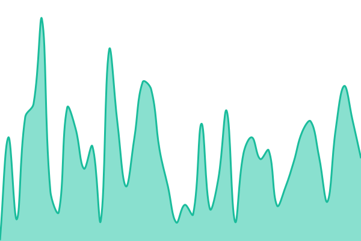 146ms
     
 | 

<a href="https://TW641.github.io/status/history/tw-641-vercel-sch-cake">100.00%</a>
    

|  [TW641 Vercel 備援網站 - padavan-builder-workflow](https://tw641.vercel.app/padavan-builder-workflow/) | 🟩 Up | [tw-641-vercel-padavan-builder-workflow.yml](https://github.com/TW641/status/commits/HEAD/history/tw-641-vercel-padavan-builder-workflow.yml) | 

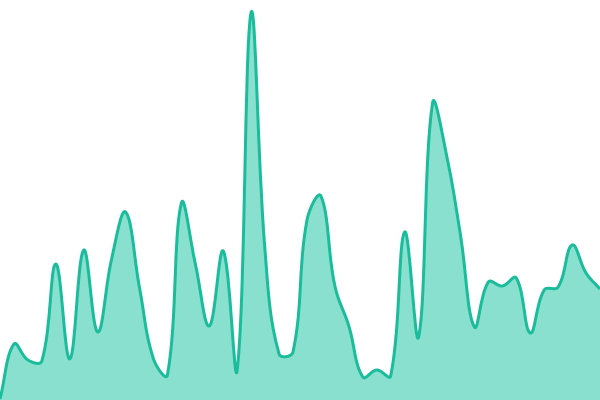 151ms
     
 | 

<a href="https://TW641.github.io/status/history/tw-641-vercel-padavan-builder-workflow">100.00%</a>
    

|  [TW641 Vercel 備援網站 - padavan-ng](https://tw641.vercel.app/padavan-ng/) | 🟩 Up | [tw-641-vercel-padavan-ng.yml](https://github.com/TW641/status/commits/HEAD/history/tw-641-vercel-padavan-ng.yml) | 

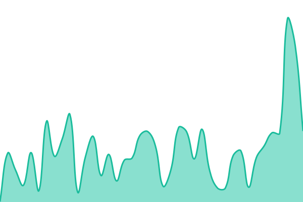 142ms
     
 | 

<a href="https://TW641.github.io/status/history/tw-641-vercel-padavan-ng">100.00%</a>
    

|  [TW641 Vercel 備援網站 - padavan-4.4](https://tw641.vercel.app/padavan-4.4/) | 🟩 Up | [tw-641-vercel-padavan-4-4.yml](https://github.com/TW641/status/commits/HEAD/history/tw-641-vercel-padavan-4-4.yml) | 

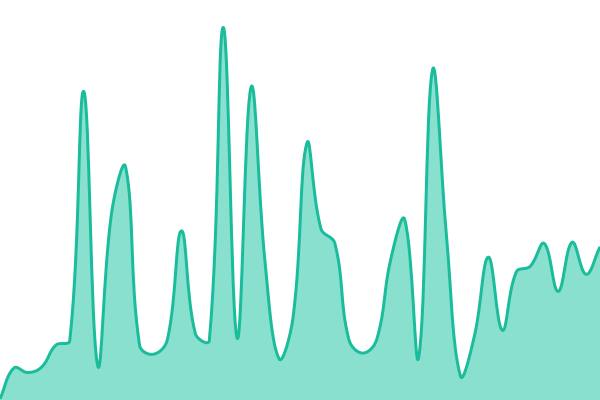 123ms
     
 | 

<a href="https://TW641.github.io/status/history/tw-641-vercel-padavan-4-4">100.00%</a>
    

|  [TW641 Render 備援網站 - 首頁](https://tw641.onrender.com/) | 🟩 Up | [tw-641-render.yml](https://github.com/TW641/status/commits/HEAD/history/tw-641-render.yml) | 

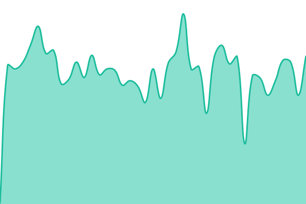 276ms
     
 | 

<a href="https://TW641.github.io/status/history/tw-641-render">100.00%</a>
    

|  [TW641 Render 備援網站 - daves-guitar-2026](https://tw641.onrender.com/daves-guitar-2026/) | 🟩 Up | [tw-641-render-daves-guitar-2026.yml](https://github.com/TW641/status/commits/HEAD/history/tw-641-render-daves-guitar-2026.yml) | 

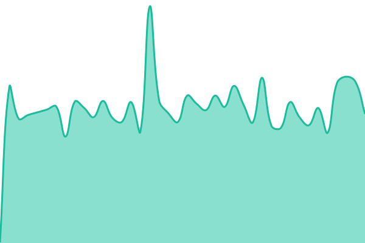 263ms
     
 | 

<a href="https://TW641.github.io/status/history/tw-641-render-daves-guitar-2026">100.00%</a>
    

|  [TW641 Render 備援網站 - Padavan-CAKE](https://tw641.onrender.com/Padavan-CAKE/) | 🟩 Up | [tw-641-render-padavan-cake.yml](https://github.com/TW641/status/commits/HEAD/history/tw-641-render-padavan-cake.yml) | 

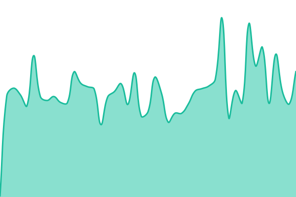 201ms
     
 | 

<a href="https://TW641.github.io/status/history/tw-641-render-padavan-cake">100.00%</a>
    

|  [TW641 Render 備援網站 - sch_cake](https://tw641.onrender.com/sch_cake/) | 🟩 Up | [tw-641-render-sch-cake.yml](https://github.com/TW641/status/commits/HEAD/history/tw-641-render-sch-cake.yml) | 

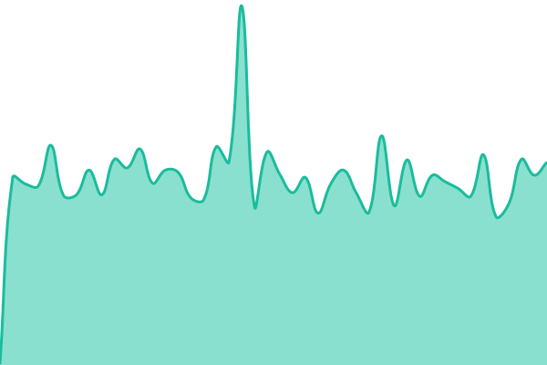 254ms
     
 | 

<a href="https://TW641.github.io/status/history/tw-641-render-sch-cake">100.00%</a>
    

|  [TW641 Render 備援網站 - padavan-builder-workflow](https://tw641.onrender.com/padavan-builder-workflow/) | 🟩 Up | [tw-641-render-padavan-builder-workflow.yml](https://github.com/TW641/status/commits/HEAD/history/tw-641-render-padavan-builder-workflow.yml) | 

 258ms
     
 | 

<a href="https://TW641.github.io/status/history/tw-641-render-padavan-builder-workflow">100.00%</a>
    

|  [TW641 Render 備援網站 - padavan-ng](https://tw641.onrender.com/padavan-ng/) | 🟩 Up | [tw-641-render-padavan-ng.yml](https://github.com/TW641/status/commits/HEAD/history/tw-641-render-padavan-ng.yml) | 

 289ms
     
 | 

<a href="https://TW641.github.io/status/history/tw-641-render-padavan-ng">100.00%</a>
    

|  [TW641 Render 備援網站 - padavan-4.4](https://tw641.onrender.com/padavan-4.4/) | 🟩 Up | [tw-641-render-padavan-4-4.yml](https://github.com/TW641/status/commits/HEAD/history/tw-641-render-padavan-4-4.yml) | 

 275ms
     
 | 

<a href="https://TW641.github.io/status/history/tw-641-render-padavan-4-4">100.00%</a>
    

|  [TW641 Surge 備援網站 - 首頁](https://tw641.surge.sh/) | 🟩 Up | [tw-641-surge.yml](https://github.com/TW641/status/commits/HEAD/history/tw-641-surge.yml) | 

 1219ms
     
 | 

<a href="https://TW641.github.io/status/history/tw-641-surge">100.00%</a>
    

|  [TW641 Surge 備援網站 - daves-guitar-2026](https://tw641.surge.sh/daves-guitar-2026/) | 🟩 Up | [tw-641-surge-daves-guitar-2026.yml](https://github.com/TW641/status/commits/HEAD/history/tw-641-surge-daves-guitar-2026.yml) | 

 745ms
     
 | 

<a href="https://TW641.github.io/status/history/tw-641-surge-daves-guitar-2026">100.00%</a>
    

|  [TW641 Surge 備援網站 - Padavan-CAKE](https://tw641.surge.sh/Padavan-CAKE/) | 🟩 Up | [tw-641-surge-padavan-cake.yml](https://github.com/TW641/status/commits/HEAD/history/tw-641-surge-padavan-cake.yml) | 

 559ms
     
 | 

<a href="https://TW641.github.io/status/history/tw-641-surge-padavan-cake">100.00%</a>
    

|  [TW641 Surge 備援網站 - sch_cake](https://tw641.surge.sh/sch_cake/) | 🟩 Up | [tw-641-surge-sch-cake.yml](https://github.com/TW641/status/commits/HEAD/history/tw-641-surge-sch-cake.yml) | 

 715ms
     
 | 

<a href="https://TW641.github.io/status/history/tw-641-surge-sch-cake">100.00%</a>
    

|  [TW641 Surge 備援網站 - padavan-builder-workflow](https://tw641.surge.sh/padavan-builder-workflow/) | 🟩 Up | [tw-641-surge-padavan-builder-workflow.yml](https://github.com/TW641/status/commits/HEAD/history/tw-641-surge-padavan-builder-workflow.yml) | 

 681ms
     
 | 

<a href="https://TW641.github.io/status/history/tw-641-surge-padavan-builder-workflow">100.00%</a>
    

|  [TW641 Surge 備援網站 - padavan-ng](https://tw641.surge.sh/padavan-ng/) | 🟩 Up | [tw-641-surge-padavan-ng.yml](https://github.com/TW641/status/commits/HEAD/history/tw-641-surge-padavan-ng.yml) | 

 665ms
     
 | 

<a href="https://TW641.github.io/status/history/tw-641-surge-padavan-ng">100.00%</a>
    

|  [TW641 Surge 備援網站 - padavan-4.4](https://tw641.surge.sh/padavan-4.4/) | 🟩 Up | [tw-641-surge-padavan-4-4.yml](https://github.com/TW641/status/commits/HEAD/history/tw-641-surge-padavan-4-4.yml) | 

 501ms
     
 | 

<a href="https://TW641.github.io/status/history/tw-641-surge-padavan-4-4">100.00%</a>
    

<!--end: status pages-->

[**Visit our status website →**](https://TW641.github.io/status)

## 📄 License

- Powered by: [Upptime](https://github.com/upptime/upptime)
- Code: [MIT](./LICENSE) © [Anand Chowdhary](https://anandchowdhary.com)
- Data in the `./history` directory: [Open Database License](https://opendatacommons.org/licenses/odbl/1-0/)
